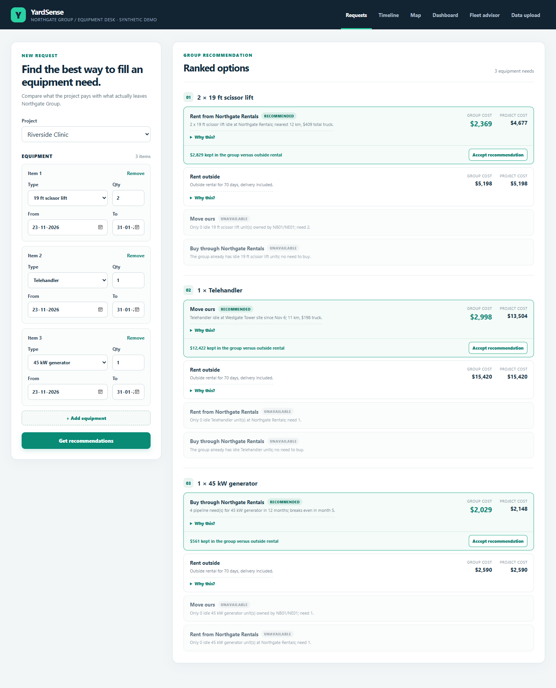
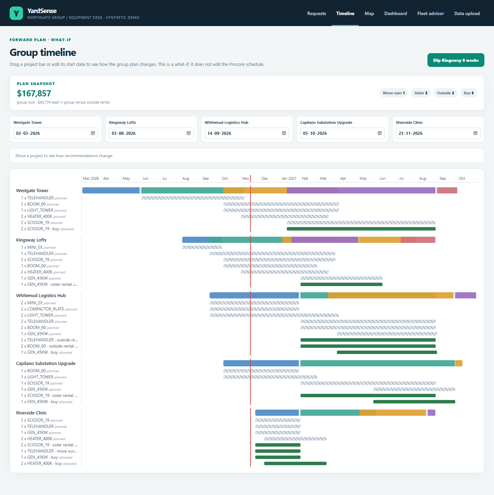
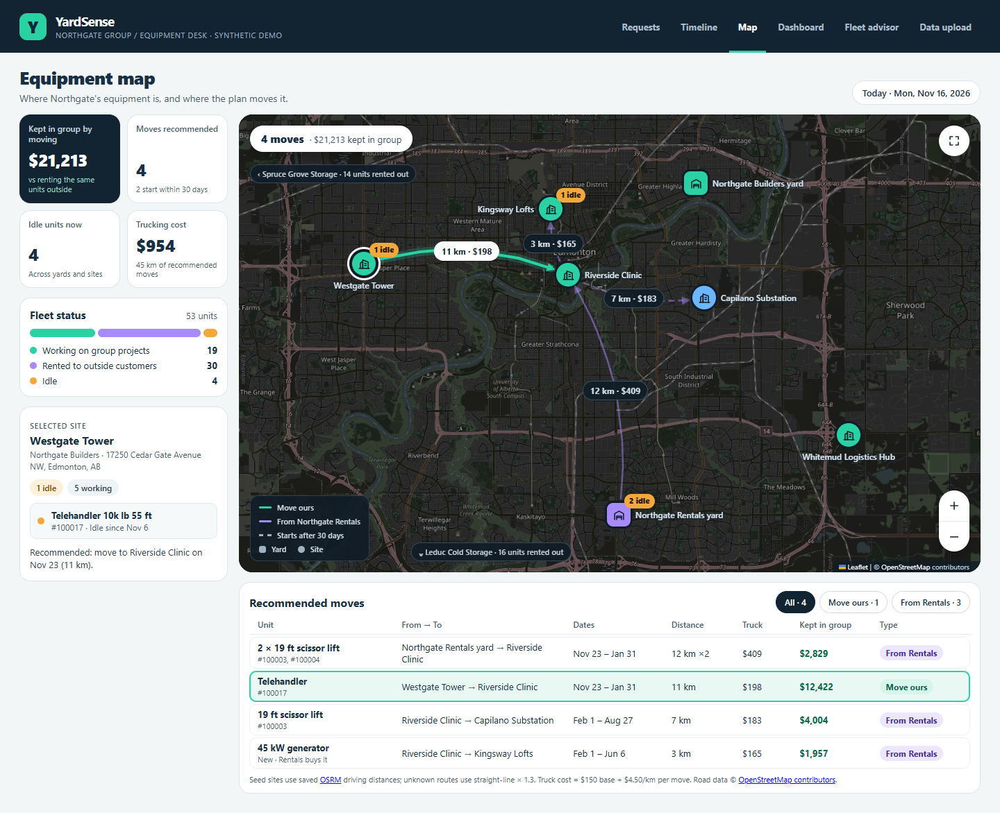
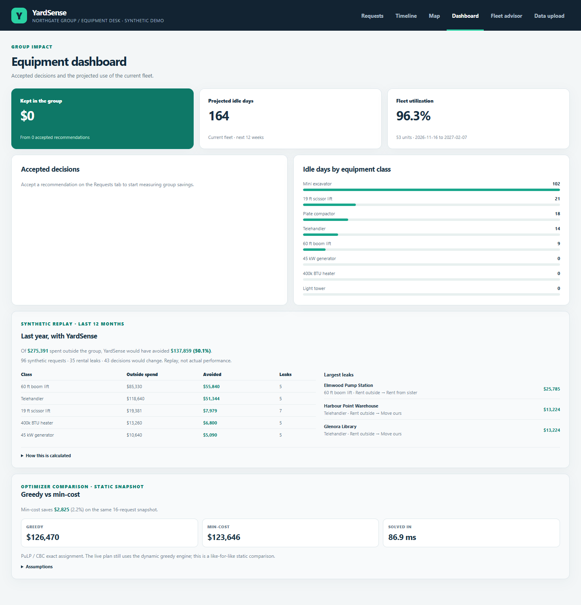
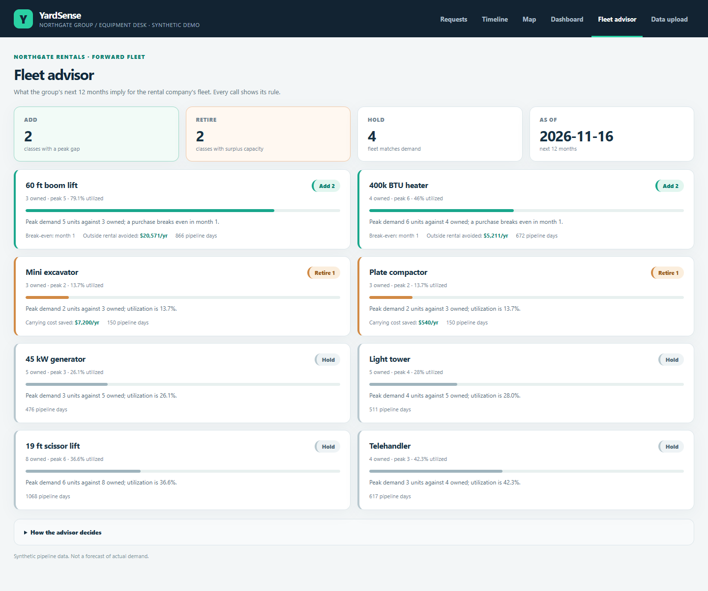
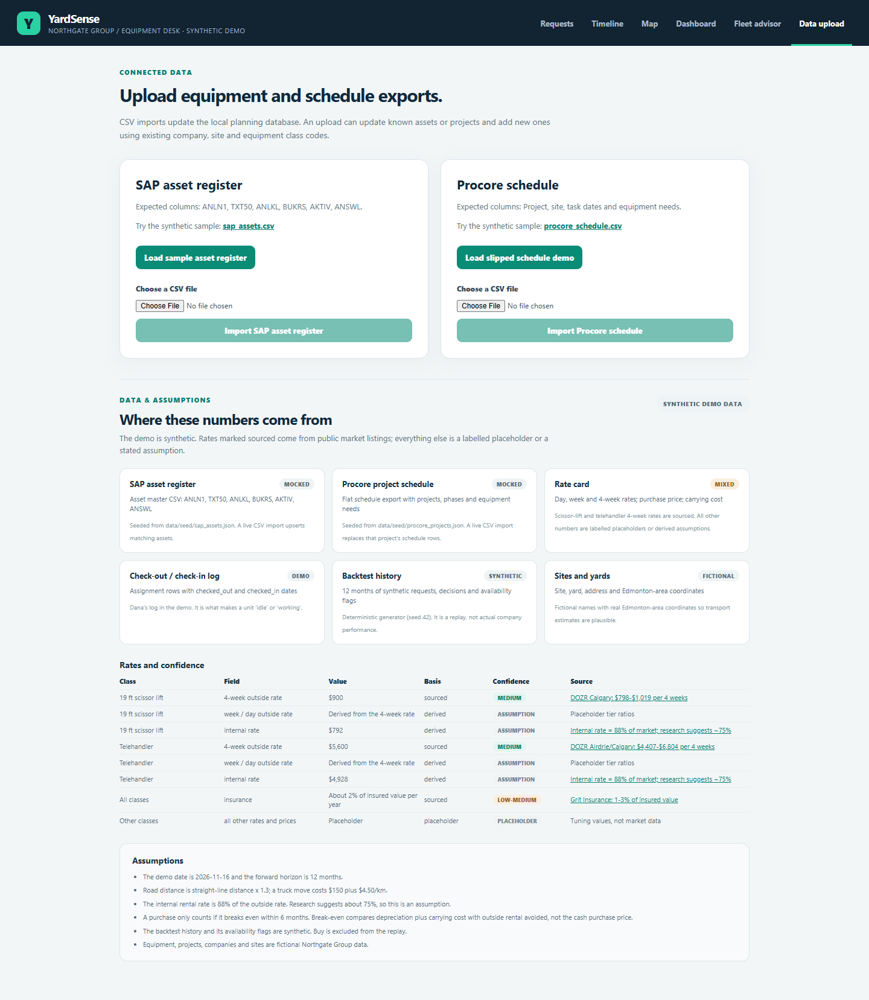

# YardSense

**natHacks 2026 · Construction & Manufacturing track**

Equipment decisions in a group of companies are made project by project, by phone, so rental money leaves the group while the group's own equipment sits idle. YardSense tells the equipment coordinator what to do for each request: **move a unit the group owns**, **rent from the group's rental company**, **rent outside**, or **have the rental company buy it**. It picks the cheapest option for the *whole group*, looking across every upcoming project. No trackers: it reads the SAP asset register and Procore schedules a contractor already has. A Textura leak report is on the roadmap.

> All project code is written during natHacks 2026 (Nov 6–9). The demo uses a fictional company group (**Northgate Group**) and synthetic data.

## Repo layout

```
backend/      FastAPI app (Python 3.12)
frontend/     React + Vite app (Node 24)
data/seed/    fictional Northgate Group seed data (committed)
data/private/ real numbers for tuning; gitignored, never commit
docs/         design notes
pitch/        deck, script, demo video
```

## Requirements

| Tool | Version | Check |
|---|---|---|
| Python | **3.12** (see `.python-version`) | `python --version` (Windows) / `python3 --version` (macOS) |
| Node.js | **24 LTS** (see `.nvmrc`) | `node -v` |
| Git | any recent | `git --version` |

Install Python from [python.org](https://www.python.org/downloads/) (on Windows, tick **"Add python.exe to PATH"**). Install Node 24 with [nvm](https://github.com/nvm-sh/nvm) on macOS (`nvm install 24`), [nvm-windows](https://github.com/coreybutler/nvm-windows) on Windows (`nvm install 24` then `nvm use 24`), or the LTS installer from [nodejs.org](https://nodejs.org/).
## Team
| Name | Role |
|---|---|
| Gurshmeer Singh | Team lead, engine, integration |
| Rakshit | Team |
| Sreeman | Backend, engine, data |
| Aarish | Team |
| Anant | Frontend, map, infrastructure |

## How it works

- **Inputs:** SAP asset register, Procore schedules, Dana's check-out/in log, rate cards, saved OSRM road distances.
- **Availability:** the check-out log plus schedule inference — a unit frees when its project phase ends.
- **Engine:** four options, two cost lenses (project vs group), transport and wear, buy break-even across the pipeline, and a greedy allocator that reserves physical units across overlapping dates. An exact PuLP/CBC static comparison measures the greedy gap.
- **Screens:** Requests, Timeline (a what-if drag; it does not edit Procore), Map, Dashboard (synthetic backtest + optimizer comparison), Fleet advisor, and Data upload with provenance.
- **APIs:** `/recommend`, `/plan`, `/dashboard`, `/backtest`, `/fleet-advisor`, `/sources`, `/mincost`, `/uploads/{sap|procore}`, `/assets/available` (GET and POST with shifts), `/assignments`.
- **Storage:** SQLite seeded from `data/seed/`; reset with `python backend/scripts/reset_db.py`.

## Screens

| Requests | Timeline |
|---|---|
|  |  |
| **Map** | **Dashboard** |
|  |  |
| **Fleet advisor** | **Data & assumptions** |
|  |  |

All screens use the fictional Northgate Group and synthetic data.

## Tests

```bash
cd backend && python -m pytest -q          # 59 tests
cd frontend && npm test                    # 89 tests
cd frontend && npm run lint && npm run build
```

## Data and limitations

The demo is synthetic and labelled. The 4-week outside rates for the 19 ft scissor lift and the telehandler are sourced from public listings; most other rates are placeholders. `data/seed/sources.json` and the Data upload tab show the mix, citations and assumptions. The backtest is a synthetic replay, not customer performance. The min-cost panel is an exact static comparison, not the live plan; the live plan is the greedy engine. Live SAP/Procore/Textura APIs, authentication, multi-tenancy, mobile and the Textura leak report are roadmap items; the CSV connectors are real code in the systems' shapes.

## Run

You need **two terminals**: one for the backend, one for the frontend.

### 1. Clone

```bash
git clone https://github.com/singhg349-wq/yardsense-nathacks26.git
cd yardsense-nathacks26
```

### 2. Backend (terminal 1)

**macOS**

```bash
cd backend
python3.12 -m venv .venv
source .venv/bin/activate
pip install -r requirements.txt
brew install cbc
uvicorn app.main:app --reload
```

**Windows (PowerShell)**

```powershell
cd backend
py -3.12 -m venv .venv
.venv\Scripts\Activate.ps1
pip install -r requirements.txt
uvicorn app.main:app --reload
```

> If PowerShell says running scripts is disabled, run this once, then activate again:
> `Set-ExecutionPolicy -Scope CurrentUser RemoteSigned`
> In Command Prompt (cmd) use `.venv\Scripts\activate.bat` instead.

You can name your venv something other than `.venv`, but add that folder name to the root `.gitignore` so it is never committed.

Check it: open <http://localhost:8000/health>. You should see `{"status":"ok",...}`. API docs are at <http://localhost:8000/docs>.

Next time you only need to activate the venv (`source .venv/bin/activate` or `.venv\Scripts\Activate.ps1`) and run `uvicorn app.main:app --reload`.

### 3. Frontend (terminal 2, same on macOS and Windows)

```bash
cd frontend
npm install
npm run dev
```

Open <http://localhost:5173>. The **Requests** tab loads Riverside Clinic's three demo needs and ranked options; open **Why this?** on any option to see its cost breakdown. On **Timeline**, drag Kingsway Lofts six weeks later to see the generator recommendation flip — the drag is a what-if, it does not edit the Procore schedule. Importing `data/samples/procore_schedule.csv` on the **Data upload** tab produces the same change through the real-data path. **Map** shows yards, sites, idle units and the recommended moves, and updates when you move a project on Timeline (the basemap tiles need internet; set `VITE_CARTO_KEY` in `frontend/.env` for CARTO's dark tiles, otherwise it uses darkened OpenStreetMap tiles). Truck costs use a [saved driving-distance matrix](data/seed/README.md), so recommendations need no live routing service. **Dashboard** tracks accepted savings, projected fleet idle days and a synthetic 12-month backtest. **Fleet advisor** shows the add/retire calls for Northgate Rentals. **Data upload** also lists where every number comes from, its confidence and the model's assumptions. To restore the starting state, run `python backend/scripts/reset_db.py` from the repo root. If you edit `data/seed/rates.json` or another seed file, run that reset command so SQLite reloads it. If the app shows an API error, check that the backend is running in terminal 1.

## Troubleshooting

- **`python3.12` / `py -3.12` not found:** Python 3.12 isn't installed or isn't on PATH. Reinstall it from python.org.
- **Port 5173 or 8000 already in use:** stop the other process (an old `npm run dev` / `uvicorn` in another terminal).
- **Frontend shows an API error:** the backend must be running on port 8000. To point at another URL, copy `frontend/.env.example` to `frontend/.env` and edit `VITE_API_URL`.
- **`npm install` warns about the Node engine:** you're not on Node 24. Run `nvm use 24`.

## Adding dependencies

- **Backend:** `pip install <pkg>`, then add `<pkg>==<version>` to `backend/requirements.txt` by hand. Don't paste `pip freeze` output: it pins macOS-only packages that break Windows installs.
- **Frontend:** `npm install <pkg>` updates `package.json` and `package-lock.json`. Commit both.

## Credits

Team: Gurshmeer, Rakshit, Sreeman, Aarish, Anant. Industry guidance from a construction professional (not a team member).
